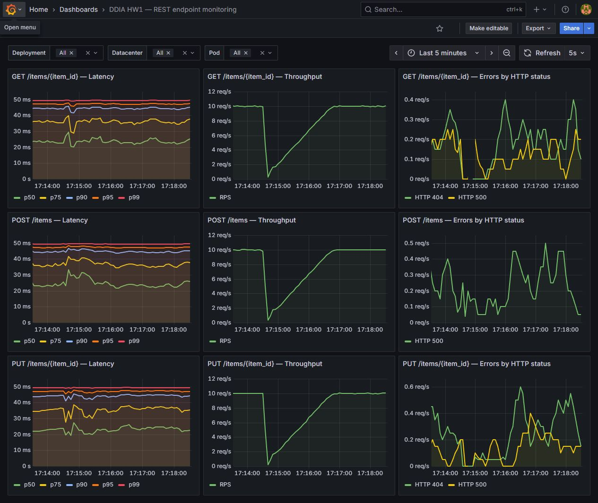

# HW1 MSE/MHS

FastAPI, VictoriaMetrics и Grafana. Дашборд и фоновая нагрузка запускаются сами.

Нужен Docker с Linux-контейнерами. Из папки проекта:

```sh
docker compose up --build -d
```

Через пару минут открой [Grafana](http://localhost:3000/d/ddia-hw-1). Логин — `admin`.
Пароль создаётся при первом запуске. Скопировать его в файл:

```sh
docker compose cp grafana:/run/credentials/grafana-password grafana-password.txt
```

Открой `grafana-password.txt` в редакторе. Файл исключён из Git.

API: [первый экземпляр](http://localhost:8001/docs), [второй](http://localhost:8002/docs).
Настройки при необходимости можно задать в `.env` по примеру `.env.example`.

Проверить контейнеры:

```sh
docker compose ps -a
```

Остановить:

```sh
docker compose down
```


